# Языки программирования
## Лабораторная работа 8

### Задание 1 **(2)**
*Рассмотрим программу на языке* **Python**.
```
x = [int(t) for t in input().split()]
for i in range(len(x)):
   if x[i] < i or x[i] > 2*i:
      break
print(i)
```
*Перепишите эту программу так, чтобы в ней использовался цикл* **while**, *в ней не использовалась
инструкция* **break**, *а используемый алгоритм не изменился. Полученная программа должна иметь следующий
вид.*
```
x = [int(t) for t in input().split()]
i = 0
while ...:
   i += 1
print(i)
```
*Допишите правильное логическое выражение вместо многоточия. Выражение не должно содержать оператор* **not**.

**Решение**

```python
x = [int(t) for t in input().split()]
i = 0
while i < len(x) - 1 and i <= x[i] <= 2 * i:
   i += 1
print(i)
```

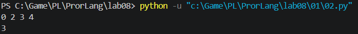

for i in range(len(x)): вот эта строчка у нас даст вот это условие i < len(x) - 1, и тут может быть вопрос типо, почему строгое и т.д. Вот пример просто

for i in range(2): i принимает значения 0, затем 1 и на этом цикл кончается. i так и остаётся равным 1, и print(i) выводит 1.

while i < len(x):

i = 0: условие верно, i += 1, теперь i = 1.

i = 1: условие верно (1 < 2), i += 1, теперь i = 2.

i = 2: условие i < len(x) ложно, цикл выходит. print(i) выводит 2.

if x[i] < i or x[i] > 2*i: вот этот if вот это if x[i] < i or x[i] > 2*i,

 в целом всё, ещё я прикреплю слайдик из лекции который рассказывает про break и постусловие.

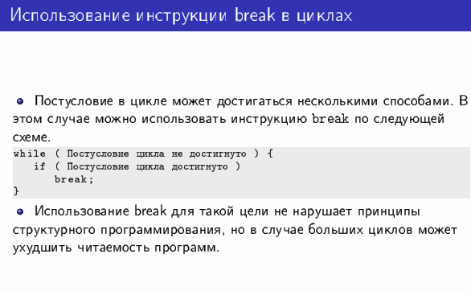

### Задание 2 **(2)**
*Рассмотрим программу на языке* **Python**.
```
x = [int(t) for t in input().split()]
for i in range(len(x)):
   if i <= x[i] < 2*i or 3*i <= x[i] < 4*i:
      break
print(i)
```
*Перепишите эту программу так, чтобы в ней использовался цикл* **while**, *в ней не использовалась
инструкция* **break**, *а используемый алгоритм не изменился. Полученная программа должна иметь следующий
вид.*
```
x = [int(t) for t in input().split()]
i = 0
while ...:
   i += 1
print(i)
```
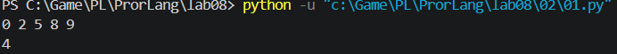

*Допишите правильное логическое выражение вместо многоточия. Выражение не должно содержать оператор* **not**.

**Решение**

```python
x = [int(t) for t in input().split()]
i = 0
while i < len(x) - 1 and (x[i] < i or x[i] >= 2 * i) and (x[i] < 3 * i or x[i] >= 4 * i):
   i += 1
print(i)
```

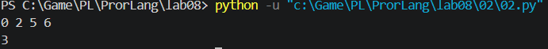

тоже самое просто тут ещё и or меняем на and и and на or.

### Задание 3 **(2)**

*Напишите пример программы на* **Java** *с двумя вложенными циклами и инструкцией* **break** *для выхода
из двух вложенных циклов. В качестве такой программы можно взять поиск первого нуля в двумерном массиве.*

**Решение**

```java
public class Main {
    public static void main(String[] args) {
        int[][] a = {
            {5, 3, 8},
            {2, 7, 0},
            {4, 0, 9}
        };
        boolean f = false;
        int row = -1, col = -1;

        for (int i = 0; i < a.length; i++) {
            for (int j = 0; j < a[i].length; j++) {
                if (a[i][j] == 0) {
                    f = true;
                    row = i;
                    col = j;
                    break;
                }
            }
            if (f) {
                break;         
            }
        }

        if (f) System.out.println("Первый ноль: " + row + " " + col);
        else System.out.println("Нулей нет");
    }
}
```

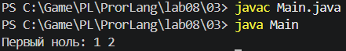

Тут крч ещё можно было написать что-то типо такого 
```java
search:
    циклы{
        ...
        break search;
    }

```

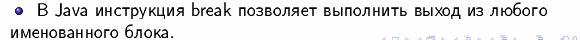

### Задание 4 **(2)**
*Рассмотрим программу на языке* **Python**.
```
a = list(range(10))
b = [a.pop() - x for x in a]
print(*b)
```
*Объясните, почему список* **b** *получился именно таким.*

```py
a = list(range(10))
b = []
for x in a:
    b.append(a.pop() - x)
print(*b)
```

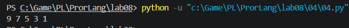

**Решение**

Программа выводит 9 7 5 3 1.

цикл идёт по списку a и одновременно этот же список укорачивается через pop(). Используется метод с побочным эффектом (pop меняет список).

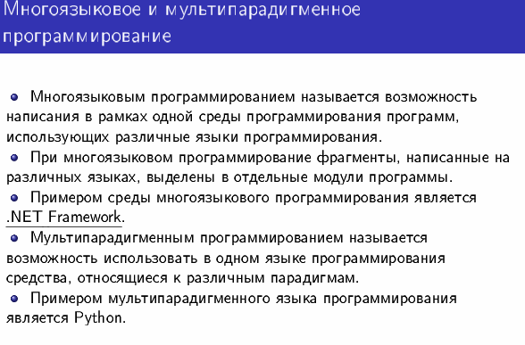

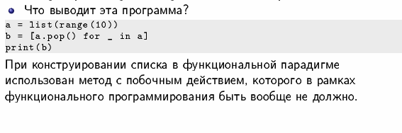

### Задание 5 **(2)**

*Напишите программу на С++, которая прочитает натуральное число* **n**, *создаст вектор
из* **n** *элементов, прочитает значения элементов, добавит последний элемент вектора к каждому элементу
(в том числе и к последнему), найдет и выведет количество положительных и отрицательных элементов вектора
после изменения. Из циклов в программе можно использовать только циклы по коллекции.*

**Решение**

```cpp
#include <iostream>
#include <vector>
using namespace std;

int main() {
    int n;
    cin >> n;
    vector<int> v(n);
    for (int &x : v) { 
        cin >> x;
    }

    int last = v.back(); 
    for (int &x : v) {
        x += last;
    }

    int pos = 0, neg = 0;
    for (int x : v) {        
        if (x > 0) pos++;
        else if (x < 0) neg++;
    }
    cout << pos << " " << neg << endl;
    return 0;
}
```

Пример: на вход 5 и 1 -2 3 -10 4. Последний элемент 4, после прибавления получается 5 2 7 -6 8. 

Ответ: 4 1.

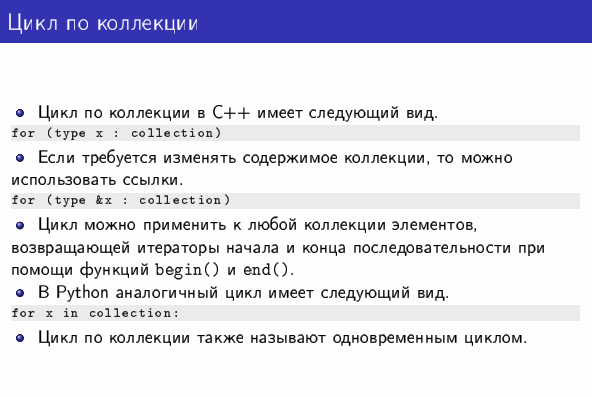

### Задание 6 **(3)**
*Представим, что в некотором будущем стандарте* **С++** *появится конструкция*
```
forc(i, from, to)
```
*которая будет раскрываться в следующий код.*
```
{
   int __i = from;
   for(const int i=from, __n=to; i < __n; __i++) {
      ...
   }
}
```

1. **Счётчик i нельзя менять внутри цикла.** Он const, поэтому i++ в теле даст ошибку компиляции. Меняется только скрытый __i, и только самим циклом. В обычном for счётчик можно трогать как угодно.
2. **Граница to считается один раз.** Она сразу кладётся в __n. В обычном for условие i < to проверяется заново на каждом шаге, и если to поменялась внутри цикла, цикл это заметит. В forc не заметит.


### Задание 7 **(2)**

*Напишите программу на языке* **Python** *для проверки того, что все числа во введенной
последовательности неотрицательные. Если в цикле будет найдено отрицательное число, цикл должен
прерваться и вывести найденное число. Если отрицательных чисел нет, то вывести некоторое сообщение об этом.*

*Программа должна использовать конструкцию* **for break else**.

*Запишите аналогичную программу на С++. Какие изменения в алгоритме решения в ней появились?. Почему?*

*Написанные программы сохраните в папку с номером задания.*

**Решение, Python**

```python
a = list(map(int, input().split()))
for x in a:
    if x < 0:
        print("Нашли отрицательное:", x)
        break
else:
    print("Отрицательных нет")
```

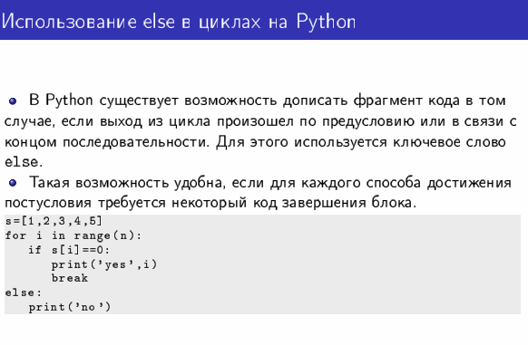

**Решение, C++**

```cpp
#include <iostream>
#include <vector>
using namespace std;

int main() {
    int n;
    cin >> n;
    vector<int> a(n);
    for (int &x : a) cin >> x;

    bool found = false;           
    for (int x : a) {
        if (x < 0) {
            cout << "Нашли отрицательное: " << x << endl;
            found = true;
            break;
        }
    }
    if (!found) {
        cout << "Отрицательных нет" << endl;
    }
}
```

**Что изменилось.** Появилась лишняя переменная-флаг `found` и отдельный `if` после цикла.

**Почему.** В C++ у циклов нет `else`. Поэтому надо как-то запомнить, как мы вышли из цикла: по `break` или дойдя до конца. Для этого и нужен флаг.

### Задание 8 **(2)**

*Рассмотрим следующую программу.*
```
if x>=5 and y>=-5:
   print(0):
elif x<0 or y<0:
   print(1)
else:
   print(2)
```
*Опишите множества значений при которых программа выводит 0, 1 и 2. Например,*

A={ (x,y)| x ∈ [5;∞), y ∈ [-5;∞)}

**Решение**

- **0**: A0 = { (x,y) | x ∈ [5;∞), y ∈ [-5;∞) }
- **1**: A1 = { (x,y) | x ∈ (-∞;0), y любое } ∪ { (x,y) | x ∈ [0;5), y ∈ (-∞;0) } ∪ { (x,y) | x ∈ [5;∞), y ∈ (-∞;-5) }
- **2**: A2 = { (x,y) | x ∈ [0;5), y ∈ [0;∞) }

Как получилось:

- Ноль выводится, когда сработало первое условие, тут всё прямо из кода.
- Единица выводится, если первое условие не сработало, но x<0 или y<0. По x:
  - если x < 0, то подходит любой y;
  - если 0 <= x < 5, то нужно y < 0 (первое условие всё равно не сработает, так как x < 5);
  - если x >= 5, то первое условие не сработало только при y < -5, и тогда y < 0 выполнено само.
- Двойка выводится в остальных случаях: x >= 0 и y >= 0, но первое условие не сработало. Значит x < 5.

Эти три множества не пересекаются и вместе покрывают всю плоскость. Я ещё проверил это на случайных точках.


### Задание 9 **(3)**
*Напишите программу на языке Python для решения следующей задачи.*

*Задана пронумерованная последовательность логических значений* **t(0),t(1),..,t(n)**, **t(i) ∈ {False,True}**

*Последовательность обладает следующим свойством: существует некоторое число k такое, что
все значения* **t(0),t(1),...,t(k-1)** *равны* **False**, *а все значения* **t(k), ... , t(n)** *равны* **True**,
*то есть слева от* **k** *находятся значения* **False**, *а справа* - **True**. *Последовательность задается
функцией* **t(i)**, *которая возвращает логическое значение. Например, для тестирования эту функцию можно
задать следующим образом.*
```
def t(i)
   return i>=1000
```

*Требуется написать программу, которая найдет число* **k**. *Программа должна реализовывать алгоритм
бинарного поиска. Диапазон поиска задается переменными* **left** и **right**. *На каждом шаге вычисляется
центр диапазона, значение в нем проверяется, после чего диапазон сокращается в два раза.*

*Алгоритм должен быть записан через цикл* **while** *и реализовывать инвариант цикла*

t(left)=False ∧ T(right)=True

```
left = 0
right = 10**18
while ...:
   mid = ...
   if t(mid):
      ...
   else:
      ...
print(...)
```

**Решение**

```python
def t(i):
    return i >= 1000

left = 0
right = 10**18
while right - left > 1:
    mid = (left + right) // 2
    if t(mid):
        right = mid
    else:
        left = mid
print(right)
```

Вывод: `1000`.

Как это работает. Мы держим две границы: слева всегда `False`, справа всегда `True`. Это и есть инвариант. Берём середину:

- если в середине `True`, то правая граница переезжает в середину, и справа по-прежнему `True`;
- если там `False`, то левая граница переезжает в середину, и слева по-прежнему `False`.

Инвариант после каждого шага остаётся верным. Диапазон на каждом шаге сжимается вдвое, поэтому даже для `10**18` хватит около 60 шагов.

Когда цикл заканчивается, `right - left <= 1`. Вместе с инвариантом это значит, что `left` и `right` стоят вплотную: слева `False`, справа `True`. Значит `k = right`. Именно так в лекции получают постусловие: инвариант плюс условие выхода.

Одна оговорка: программа считает, что `t(0)` это `False` (иначе `left = 0` не подходит под инвариант) и что `t(10**18)` это `True`.

Инвариант цикла: выражение, которое истинно при входе в цикл и после каждой итерации (а значит и при выходе).


## Дополнительные задания

### Задание 1 **(5)**

*Напишите программу на языке С++, которая будет находить сумму элементов в матрице и использовать для суммирования только один цикл* **for**. *(То есть вложенные циклы использовать нельзя).*

**Решение**

```cpp
#include <iostream>
#include <vector>
using namespace std;

int main() {
    int n, m;
    cin >> n >> m;
    vector<vector<int>> a(n, vector<int>(m));
    for (int k = 0; k < n * m; k++) {
        cin >> a[k / m][k % m];
    }

    long long sum = 0;
    for (int k = 0; k < n * m; k++) {
        sum += a[k / m][k % m];
    }
    cout << sum << endl;
}
```

Идея: вместо двух счётчиков (строка и столбец) один счётчик `k` от 0 до `n*m - 1`. Номер строки это `k / m`, номер столбца это `k % m`. Так мы обходим все клетки по порядку, как будто матрица вытянута в одну линию.

Пример: на вход `2 3` и `1 2 3 4 5 6`, ответ `21`.

### Задание 2 **(15)**
*Напишите программы на языке С++ с использованием разных видов циклов, ветвлений в полной и краткой форме, переведите их в ассемблерный код без оптимизации и опишите, как реализуются эти конструкции в элементарных командах.*

**Решение**

Ассемблер получен командой:
```
g++ -S -O0 -masm=intel file.cpp
```
`-O0` значит без оптимизации. Ниже я убрал служебные строки и оставил только суть (начало функции `push rbp / mov rbp, rsp` и конец `pop rbp / ret` тоже пропущены).

Что нужно знать, чтобы читать код:

- аргумент функции приходит в регистре `edi`, а без оптимизации компилятор сразу кладёт его в память, например `[rbp-20]`. Все переменные лежат в памяти, поэтому столько `mov`;
- `cmp a, b` сравнивает и записывает результат в служебные флаги;
- `jle`, `jg`, `jl` это условные переходы. Они смотрят на флаги и либо прыгают на метку, либо идут дальше. `jmp` прыгает всегда;
- `.L2:`, `.L3:` это просто метки, места, куда прыгаем.

Вся структура цикла и ветвления сводится к `cmp` и прыжкам. Больше в процессоре ничего нет.

**1. Ветвление `if / else`**

```cpp
int f_if(int a) {
    int r;
    if (a > 0)
        r = 1;
    else
        r = 2;
    return r;
}
```
```asm
    mov   DWORD PTR -20[rbp], edi   ; a лежит в [rbp-20]
    cmp   DWORD PTR -20[rbp], 0     ; сравниваем a с 0
    jle   .L2                       ; если a <= 0, прыгаем на else
    mov   DWORD PTR -4[rbp], 1      ; r = 1   (ветка if)
    jmp   .L3                       ; перепрыгиваем else
.L2:
    mov   DWORD PTR -4[rbp], 2      ; r = 2   (ветка else)
.L3:
    mov   eax, DWORD PTR -4[rbp]    ; return r
```
Обратите внимание: условие в `if` `a > 0`, а прыжок стоит `jle`, то есть наоборот. Компилятор прыгает, когда условие НЕ выполнено, чтобы обойти ветку `if`. А `jmp .L3` в конце ветки `if` нужен, чтобы после неё не выполнилась ещё и ветка `else`.

**2. Краткая форма ветвления `?:`**

```cpp
int f_tern(int a) {
    return a > 0 ? 1 : 2;
}
```
```asm
    mov   DWORD PTR -4[rbp], edi
    cmp   DWORD PTR -4[rbp], 0
    jle   .L6                       ; a <= 0, идём во вторую ветку
    mov   eax, 1                    ; результат 1
    jmp   .L8
.L6:
    mov   eax, 2                    ; результат 2
.L8:
```
Вышло почти то же самое, что с `if / else`. Разница лишь в том, что результат сразу кладётся в `eax` (там у функции лежит возвращаемое значение), без промежуточной переменной `r`. То есть `?:` это просто короткая запись `if / else`.

**3. Цикл `while`**

```cpp
int f_while(int n) {
    int s = 0;
    while (n > 0) {
        s += n;
        n--;
    }
    return s;
}
```
```asm
    mov   DWORD PTR -20[rbp], edi   ; n в [rbp-20]
    mov   DWORD PTR -4[rbp], 0      ; s = 0
    jmp   .L10                      ; сначала сразу на проверку условия
.L11:                               ; тело цикла
    mov   eax, DWORD PTR -20[rbp]
    add   DWORD PTR -4[rbp], eax    ; s += n
    sub   DWORD PTR -20[rbp], 1     ; n--
.L10:                               ; проверка условия
    cmp   DWORD PTR -20[rbp], 0
    jg    .L11                      ; если n > 0, возвращаемся в тело
```
Тут условие проверяется внизу. Но в самом начале стоит `jmp .L10`, который отправляет сначала на проверку, и поэтому, если `n` уже `<= 0`, тело не выполнится ни разу. Это и есть цикл с предусловием.

**4. Цикл `do ... while`**

```cpp
int f_do(int n) {
    int s = 0;
    do {
        s += n;
        n--;
    } while (n > 0);
    return s;
}
```
```asm
    mov   DWORD PTR -20[rbp], edi
    mov   DWORD PTR -4[rbp], 0      ; s = 0
.L14:                               ; начало тела
    mov   eax, DWORD PTR -20[rbp]
    add   DWORD PTR -4[rbp], eax    ; s += n
    sub   DWORD PTR -20[rbp], 1     ; n--
    cmp   DWORD PTR -20[rbp], 0     ; проверка в конце
    jg    .L14                      ; n > 0 ? снова в начало тела
```
Единственная разница с `while`: нет стартового `jmp` на проверку. Сначала выполняется тело, потом проверка. Поэтому тело всегда выполнится хотя бы один раз.

**5. Цикл `for`**

```cpp
int f_for(int n) {
    int s = 0;
    for (int i = 0; i < n; i++)
        s += i;
    return s;
}
```
```asm
    mov   DWORD PTR -20[rbp], edi   ; n
    mov   DWORD PTR -4[rbp], 0      ; s = 0
    mov   DWORD PTR -8[rbp], 0      ; i = 0   (инициализация)
    jmp   .L17                      ; на проверку
.L18:                               ; тело
    mov   eax, DWORD PTR -8[rbp]
    add   DWORD PTR -4[rbp], eax    ; s += i
    add   DWORD PTR -8[rbp], 1      ; i++     (шаг)
.L17:                               ; проверка
    mov   eax, DWORD PTR -8[rbp]
    cmp   eax, DWORD PTR -20[rbp]   ; i < n ?
    jl    .L18                      ; да, снова в тело
```
`for` получился такой же, как `while`, только с двумя добавками: перед циклом стоит инициализация `i = 0`, а в конце тела шаг `i++`. Выходит, `for` это тот же `while`, просто записанный компактнее. Это тоже пример синтаксического сахара из лекции (слайд 222): красиво для человека, а процессору всё равно.


**Итог.** Все конструкции собираются из двух вещей: `cmp` и прыжков.

- `if / else` и `?:`: сравнили, прыгнули мимо ветки, если условие не выполнилось.
- `while`: сначала прыжок на проверку, потом тело, потом проверка и прыжок назад.
- `do while`: то же, но без первого прыжка, поэтому тело минимум один раз.
- `for`: как `while`, плюс инициализация перед и шаг в конце тела.
