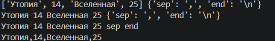
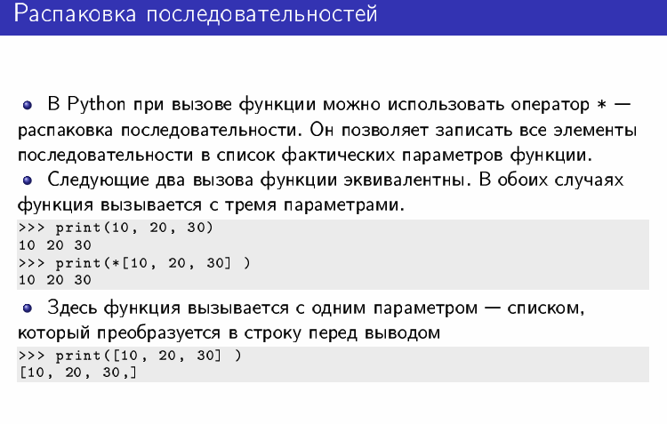
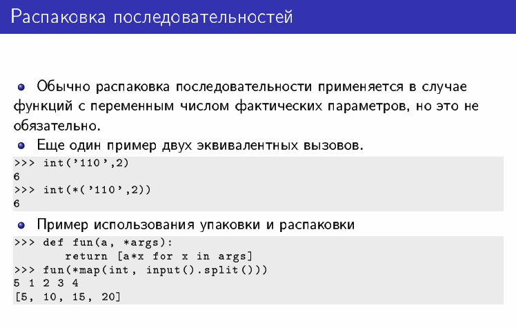
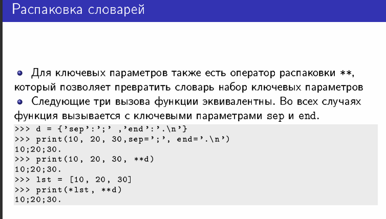
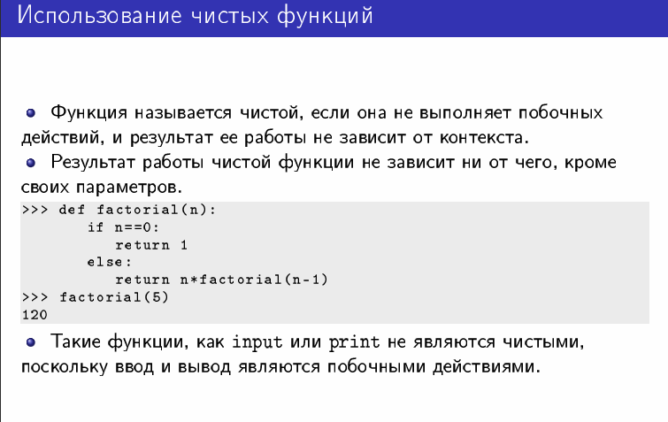
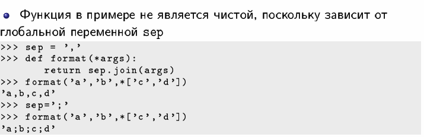
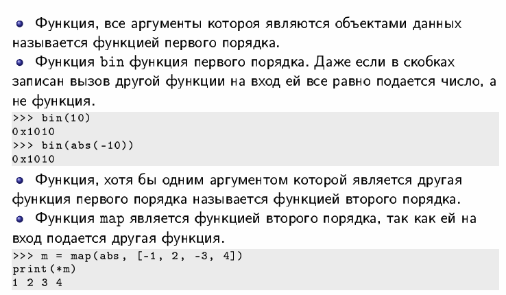

# Языки программирования
## Лабораторная работа 9

### Задание 1 **(2)**
*Рассмотрим следующую программу.*
```
d = {'sep': ',' , 'end': '\n'}
l = ['Утопия', 14, 'Вселенная', 25]
print (l, d)
print (*l, d)
print (*l, *d)
print (*l, **d)
```


*Объясните результаты ее работы.*

1) print (l, d), по сути d и l просто преобразуются в строку и выводится соответственно

2) *l просто распаковывает наш список

3) теперь распаковываются и список и словарь, соответсвенно в распакованном словаре мы видим ключи

4) тут у нас с помощью **d мы видим что оно стало набором ключевых параментров







*При устном ответе на вопросы вам потребуется рассказать, что такое "Утопия 14" и "Вселенная 25".*

Тут просто вставки из вики 


«Механическое пианино» (англ. Player Piano) или «Утопия 14» — первый роман Курта Воннегута. Опубликован в 1952 году. Действие романа-антиутопии происходит в недалёком будущем, в котором ручной труд почти повсеместно заменён машинным. Широко распространённая механизация вызывает социальные противоречия между зажиточным верхним классом — инженерами и менеджерами, — и нижним, чьи навыки были заменены машинным трудом. Книга представляет собой пример «мягкой фантастики», где основной упор делается не на технические особенности, а на социальные аспекты возможного будущего. В романе присутствуют элементы иронии и сентиментальности, которые впоследствии станут отличительной чертой прозы Воннегута.


Наиболее знаменитый эксперимент Кэлхуна был поставлен на мышах. Условное название эксперимента — «Вселенная 25» (англ. Universe 25), а число «25» — порядковый номер эксперимента. В июле 1968 года в проволочный загон в лаборатории на базе Национального института психического здоровья были помещены 4 пары мышей. Загон с 256 ящиками-гнёздами, каждое из которых было рассчитано на 15 мышей, был оборудован раздатчиками воды и корма и достаточным количеством материала для строительства гнёзд. Кэлхун описывал загон как «утопию» для мышей: по расчётам исследователей, места для гнёзд в загоне хватило бы на 3840 мышей, а постоянно подаваемой еды — на 9500. На практике численность популяции остановилась на максимальном значении в 2200 особей и после него только сокращалась. К июню 1972 года, когда Кэлхун завершил эксперимент, в загоне оставались лишь 122 мыши, которые вышли из репродуктивного возраста. Поэтому итог эксперимента уже был ясен.

### Задание 2 **(2)**
*Напишите функцию* **sublist** для решения следующей задачи.*

*На вход функции поступает список или кортеж и набор номеров позиций.
Функция должна составить и вернуть список из элементов, которые
находятся на этих позициях. Примеры работы приводятся ниже. Работа функции должна строго им соответствовать.*

```
>>> lst = [ 'Anna', 'Barbara', 'Clara', 'Diana', 'Eva', 'Flora']
>>> sublist(lst, 0, 2, 5)
['Anna', 'Clara', 'Flora']
>>> sublist (lst)
[]
>>> sublist(lst, 0, 1, 2, 3, 4, 5)
['Anna', 'Barbara', 'Clara', 'Diana', 'Eva', 'Flora']
```

```py
def sublist(lst, *num):
    res = []  
    
    for n in num: 
        res.append(lst[n])  
        
    return res

lst = [ 'Anna', 'Barbara', 'Clara', 'Diana', 'Eva', 'Flora']
print(sublist(lst, 0, 2, 5))
```

### Задание 3 **(1)**

*Задан список* **lst** *из натуральных чисел*. *Напишите фрагмент
программы, состоящий из одного вызова функции* **max**, *который найдет в этом списке число с максимальным
числом единиц в двоичной записи.* 

*Многоточие надо заменить на лямбда-функцию, использующую фукцию* **bin** *и метод строк* **count**.

*Пример работы приводится ниже.*
```
>>> lst = list(range(6000 ,7000))
>>> ans = max(lst,...)
>>> print(ans)
6143
```

```py
lst = list(range(6000, 7000))
ans = max(lst, key=lambda x: bin(x).count('1'))
print(ans, bin(ans))
```


### Задание 4 **(2)**

*Запишите фрагмент программы, которая упорядочит список слов
по длине, а при равенстве длины - лексикографически. Сортировка
должна состоять из одного вызова метода* **sort**.

*Пример работы приводится ниже.*

```
>>> lst = ['hello', 'hell', 'bye', 'world', 'bybye']
>>> lst.sort (...)
>>> print (lst)
['bye', 'hell', 'babye', 'hello', 'world']
```

```py
lst = ['hello', 'hell', 'bye', 'world', 'bybye']
lst.sort(key=lambda x: (len(x), x))
print(lst)
```

### Задание 5 **(2)**

*Напишите программу для решения следующей задачи.*

*В одной строке через запятую записана последовательность слов. Перед
запятой или после нее могут быть пробелы, сами слова пробелов не
содержат. Программа должна вывести в одной строке через запятую
последовательность чисел, равных длине каждого слова. Например,
для ввода*
```
hello   ,   world ,   and ,   goodbye
```
*программа должна вывести*
```
5, 5, 3, 7
```
*Программа должна быть написана с использованием парадигмы функционального программирования, то есть без использования циклов, присваиваний и т.д. Программа может использовать функции* **input**, **print**, **len**, **map** *и методы строк* **split** и **strip**.

```py
print(*map(len,
           map(str.strip,
               input().split(','))
            ) 
    )
```

### Задание 6 **(2)**

*Запишите генератор в форме функции, который будет создавать
последовательность по следующему правилу.*

* *Если текущее число x в последовательности четное, то следующее число равно x/2.*
* *Иначе следующее число равно 3x + 1.* 

*Последовательность начинается с заданного числа n и заканчивается единицей.*

*Далее приведен пример работы генератора.*
```
>>> print (*gen(7))
7 22 11 34 17 52 26 13 40 20 10 5 16 8 4 2 1
```

```py
def every_other(seq):
    it = iter(seq)
    flag = True
    x = next(it, None)
    while x!=None:
        if flag:
            yield x
        
        flag = not flag
        x=next(it, None)
```

### Задание 7 **(2)**

*Напишите генератор, который для заданной последовательности*
**seq** *будет задавать последовательность из каждого второго элемента* **seq**.

```
def every_other ( seq )
    ...
```
*Ниже приведены примеры использования генератра.*
```
>>> print (*every_other([10, 20, 30, 40, 50]))
10 30 50
>>> print(*every_other(range(10)))
0 2 4 6 8
>>> print(*every_other(iter(range(10))))
0 2 4 6 8
>>> print(sum(every_other(map(int, input().split()))))
2 5 11 3 8
21
```

```py
def every_other(seq):
    it = iter(seq)
    flag = True
    x = next(it, None)
    while x!=None:
        if flag:
            yield x
        
        flag = not flag
        x=next(it, None)
```

### Задание 8 **(2)**

*Задан список* **lst**, *в котором записаны вперемешку числа и строки.*. 
*Напишите фрагмент программы, состоящий из одного конструктора списков, который построит новый список, состоящий только из чисел.* 

*Определить тип объекта в Python можно с использованием функции* **type**.

*Пример работы приводится ниже.*

```
>>> lst = [1,'abc', 2, 3, 4, 'aa']
>>> nums = [...]
>>> print(nums)
[1, 2, 3, 4]
```

```py
lst = [1,'abc', 2, 3, 4, 'aa']
nums = [x for x in lst if type(x) == int]
print(nums)
[1, 2, 3, 4]
```

###  Задание 9 **(2)**

*Напишите фрагмент программы, состоящий из одного конструктора списков, который построит двумерный список в виде таблицы умножения размера* 
**n×n**.

*Пример работы приводится ниже.*

```
>>> n = 5
>>> tblmul = [...]
>>> print(*tblmul,sep='\n')
[1, 2, 3, 4, 5]
[2, 4, 6, 8, 10]
[3, 6, 9, 12, 15]
[4, 8, 12, 16, 20]
[5, 10, 15, 20, 25]
```

```py
n = 5
tblmul = [[(j+1)*(i+1) for j in range(n)] for i in range(n)]
print(*tblmul,sep='\n')
```

###  Задание 10 **(1)**
*Какие из указанных функций и методов Python соответствуют определению чистых функций?
В случае отрицательного ответа требуется дать пояснение.*



* **file.readline** — *чтение строки из файла.* не чистая. Это ввод-вывод (побочное действие).
* **len** — *определение длины строки или количества элементов в контейнере. - чистая.
* **list.append** — *добавление в список нового элемента.* - не чистая. Изменяет исходный список (побочное действие).
* **sum** — *нахождение суммы.* - чистая. 
* **sorted** — *построение сортированного списка.* - чистая.
* **list.sort** — *сортировка списка.* - не чистая. Изменяет исходный список.
* **random.randint** — *генерация случайного целого числа.* - не чистая. Зависит от внутреннего генератора чисел а не от параметра.
* *Разворот списка.*
```
def rev(x):
    return x[::-1]
``` 
чистая.
**Выбор нескольких элементов из хвоста списка.*

```
tail_len = 3
def tail(x):
    return x[-tail_len:]
``` 
результат зависит от глобальной переменной.



###  Задание 11 **(2)**
*Рассмотрите следующую функцию.*
```
def toint(fun):
    def wrapper(*args):
        return fun(*map(int, args))
    return wrapper
```
*Что передается в функцию* **toint**?

В функцию toint передаётся функция второго порядка fun(объект)
 

*Что возвращает эта функция?*

Новую функцию — wrapper. Она создаётся во время работы программы.(первоклассный объект)

*Что делает функция* **wrapper**?

Функция wrapper просто принимает набор параметров и преобразует каждый в int распаковывает результат и вызывает функцию "fun", уже с числами.

*Придумайте несколько примеров использования* **toint**.

```py
def toint(fun):
    def wrapper(*args):
        return fun(*map(int, args))
    return wrapper

def add(a, b):
    return a + b

banana = toint(add)

x = input("Первое число: ")
y = input("Второе число: ")

print(banana(x, y))
```

```py
def toint(fun):
    def wrapper(*args):
        return fun(*map(int, args))
    return wrapper

def multiply(a, b, c):
    return a * b * c

banana = toint(multiply)

a = input("a: ")
b = input("b: ")
c = input("c: ")

print("Произведение:", banana(a, b, c))
```

```py
def toint(fun):
    def wrapper(*args):
        return fun(*map(int, args))
    return wrapper

def max_of_three(a, b, c):
    return max(a, b, c)

banana = toint(max_of_three)

a = input("a: ")
b = input("b: ")
c = input("c: ")

print("Максимум:", banana(a, b, c))
```

## Дополнительные задания

