# Языки программирования
## Лабораторная работа 10

### Задание 1 **(2)**

*Рассмотрите следующие фрагменты программ. Запишите, что означают символы* **&** и  * *в каждом случае применения.*
```
int a = 10, b = 20;
int *p = &a , *q = &b;
p = q;
std::cout << *p <<' '<< *q << std::endl;
```
```
int a = 10, b = 20;
int *p = &a , *q = &b;
*p = *q;
std::cout << *p <<' '<< *q << std::endl;
```
*Чем различаются присваивания в третьей строке? Что можно вывести,
чтобы показать различия?*

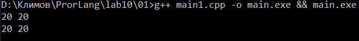

```cpp
#include <iostream>

int main() {
    {
    int a = 10, b = 20;
    int *p = &a , *q = &b;
    p = q;
    std::cout << *p <<' '<< *q << std::endl;
    std::cout << a << ' ' << b << ' ' << p << ' ' << q << std::endl;
    }
    {
    int a = 10, b = 20;
    int *p = &a , *q = &b;
    *p = *q;
    std::cout << *p <<' '<< *q << std::endl;
    std::cout << a << ' ' << b << ' ' << p << ' ' << q << std::endl;
    }
    
    return 0;
}

```

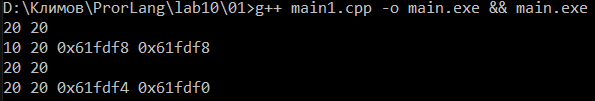

*Примеры программ сохраните в папке с номером задания. Скриншоты работы прикрепите к отчету.*


### Задание 2 **(1)**

*Рассмотрим следующую программу.* 
```
double x[10];
for (int i = 0; i <10; i++)
    std::cout << &x[i] << std::endl;
```
*Что она выводит? Измените
вывод так, чтобы адреса выводились в десятичной системе счисления.
Объясните почему числа составляют арифметическую прогрессию с
определенным шагом.*

элементы в массиве занимают одинаковый размер в памяти и все элементы располагаются последовательно друг за другом.

*Записанную программу сохраните в папке с номером задания.*
*Скриншоты работы прикрепите к отчету.*

```cpp
#include <iostream>

int main() {
    {
    double x[10];
    for (int i = 0; i < 10; i++)
        std::cout << &x[i] << std::endl;
    }
    {
    double x[10];
    for (int i = 0; i < 10; i++) {
        std::cout << reinterpret_cast<uintptr_t>(&x[i]) << std::endl;
    }
    }
        
    return 0;
}
```

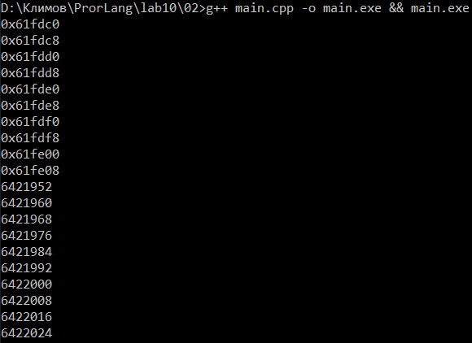

### Задание 3 **(2)**

*Токен* **«*»** *в языке C++ может использоваться в трех различных
случаях. Аналогично токен* **«&»** *также может использоваться в трех
случаях. Приведите пример одной программы в которой они были бы
использованы во всех случаях.*

*Записанную программу сохраните в папке с номером задания.*

```cpp
#include <iostream>

int main() {
    int a = 5;
    int b = 3;

    int *x = &a;          
    int y = *x;        
    int z = a * b;       

    int &x1 = a;           
    int *y1 = &b;        
    int y2 = a & b;   

    std::cout << y << " " << z << " " << x1 << " " << *y1 << " " << y2 << std::endl;
    
    return 0;
}
```

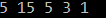

### Задание 4 **(2)**

*Выпишите значения всех переменных, в том числе указателей,
после выполнения каждой инструкции программы. Объясните, что
происходит в результате выполнения каждой инструкции.*
```
unsigned a = 8, b = 3 ,c = 17; //1
unsigned *p = &a; //2
unsigned *q = &b; //3
*p += *q + c; //4
c = *q; //5
p = &c; //6
c += a; //7
*p += 10; //8
*q = *p; //9
q = p ; //10
*q += 10; //11
```
1) a=8; b=3; c=17; просто присваивание значений переменным
2) p создаётся и хранит адрес a. p = &a
3) q создаётся и хранит адрес b. q = $b
4) *p это a, *q это b. Выполняется a = a + b + c = 8 + 3 + 17 = 28
5) в c копируется b на которое указывает q
6) Теперь p указывает на c, а не на a
7) с = с + а = 3 + 28 = 31
8) p указывает на c => c = 31 + 10 = 41
9) Значение c (*p) записывается в b (*q) b = 41.
10) q получает адрес из p, теперь оба указателя указывают на c
11) q указывает на c, значит c = 41 + 10 = 51


### Задание 5 **(1)**

*Что сравнивается в приведенной ниже программе? Как можно
изменить первую строчку программы, чтобы результат тоже
изменился?*
```
int x = 1, y = 2;
int *p = &y, *q = &x;
if (p < q)
    std::cout << "Yes";
else
    std::cout << "No";
```

```cpp
#include <iostream>

int main() {

    {
        int x = 1, y = 2;
        int *p = &y, *q = &x;
        
        if (p < q)
            std::cout << "Yes";
        else
            std::cout << "No";
            
    }

    {
    int y = 2, x = 1;
    int *p = &y, *q = &x;
        
    if (p < q)
        std::cout << "Yes";
    else
        std::cout << "No";
            
    }

    return 0;
}
```

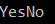

### Задание 6 **(2)**

*Объясните работу следующей программы. Как изменится
результат, если тип* **double** *изменить на некоторый другой, например*
**int** *или* **char**?
```
double x = 0;
double *d = &x;
std::cout << reinterpret_cast<size_t>(d + 4) - reinterpret_cast<size_t>(d - 4) << std::endl;
```

```cpp
#include <iostream>

int main() {
    double x = 0;
    double *d = &x;
    std::cout << "d+4=" << reinterpret_cast<size_t>(d + 4) << std::endl;
    std::cout << "d-4=" << reinterpret_cast<size_t>(d - 4) << std::endl;
    std::cout << "d=" << reinterpret_cast<size_t>(d) << std::endl;

    return 0;
}
```

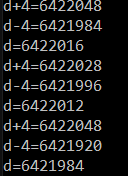

### Задание 7 **(2)**

*Объясните работу следующей программы. Как изменится
результат, если тип* **double** *изменить на некоторый другой, например*
**int** *или* **char**?
```
std::cout << reinterpret_cast <double*>(3000) - reinterpret_cast <double*>(2000) << std::endl;
```

```cpp
#include <iostream>

int main() {
    {
    std::cout << reinterpret_cast <double*>(3000) - reinterpret_cast <double*>(2000) << " " << sizeof(double) << std::endl;
    }
    {
    std::cout << reinterpret_cast <int*>(3000) - reinterpret_cast <int*>(2000) << " " << sizeof(int) << std::endl;
    }
    {
    std::cout << reinterpret_cast <char*>(3000) - reinterpret_cast <char*>(2000) << " " << sizeof(char) << std::endl;
    }
    return 0;
}

```

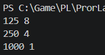

(3000-2000)/sizeof(тип)

Чем больше размер типа, тем меньше элементов помещается в один и тот же промежуток.


### Задание 8 **(2)**

*Что надо дописать в записанной ниже программе вместо многоточий, чтобы
она выводила все числа из массива* **a**? *Почему?*
```
int a[20];
for ( int i = 0; i < 20; i++)
    a[i] = i;
int *b=a + 8;
for (int i =...; i <...; i++)
    std::cout << b[i] <<' ';
```

```cpp
#include <iostream>

int main() {
    int a[20];
    for ( int i = 0; i < 20; i++)
        a[i] = i;
    int *b=a + 8;
    for (int i = -8; i < 12; i++)
        std::cout << b[i] <<' ';
}

```

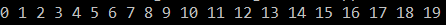

### Задание 9 **(2)**

*Что выводит следующая программа? Изменится ли результат если
изменить тип элементов массива?*

```
int a[10];
std::cout << &a[8] - &a[3] << std::endl;
```
```cpp
#include <iostream>

int main() {
    {
        int a[10];
        std::cout << &a[8] - &a[3] << std::endl;       
    }
    {
        char a[10];
        std::cout << &a[8] - &a[3] << std::endl;       
    }
    {
        double a[10];
        std::cout << &a[8] - &a[3] << std::endl;       
    }
    return 0;
}
```

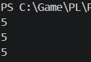

ответ 1 и тот же т.к. по факту вместе с типом меняется также расстояние между элементами и соответсвенно sizeof

char 5   5/1	 5

int	20	 20 / 4	  5

double	40	40 / 8	5

### Задание 10 **(1)**

*Есть ли разница между инициализацией* **p** и **q** *в следующей программе? Обоснуйте ответ.*
```
int x [10]={1, 2, 3, 4, 5, 6, 7, 8, 9, 10};
int *p = x + 5;
int *q = &x[5];
```
```cpp
#include <iostream>

int main() {
    int x[10] = {1, 2, 3, 4, 5, 6, 7, 8, 9, 10};
    int *p = x + 5;
    int *q = &x[5];

    std::cout << "p = " << p << std::endl;
    std::cout << "q = " << q << std::endl;
    std::cout << "p == q: " << (p == q) << std::endl;   // 1
    std::cout << "*p = " << *p << std::endl;            // 6
    std::cout << "*q = " << *q << std::endl;            // 6
    std::cout << "p - x = " << p - x << std::endl;      // 5
    std::cout << "q - x = " << q - x << std::endl;      // 5

    return 0;
}
```

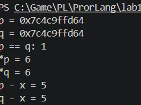

После инициализации p и q хранят один и тот же адрес: адрес элемента x[5]


### Задание 11 **(3)**

*Указатели можно использовать для итерации по массивам.
Напишите программу, которая найдет сумму элементов массива,
используя указатели. В начале цикла указатель требуется установить
на начало массива, в конце каждой итерации смещать его к
следующему элементу массива через инкремент. Для выхода из цикла
надо проверять, что указатель дошел до конца массива.*
```
int x [10]={1, 2, 3, 4, 5, 6, 7, 8, 9, 10};
int s = 0;
for (int *p = ...; ...; ...)
    s += ...
std::cout << s;
```

*Записанную программу сохраните в папке с номером задания.*

```cpp
#include <iostream>

int main() {
    int x[10] = {1, 2, 3, 4, 5, 6, 7, 8, 9, 10};
    int s = 0;
    for (int *p = x; p != x + 10; ++p)
        s += *p;
    std::cout << s << std::endl;   
    return 0;
}
```
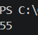

## Дополнительные задания

### Задание 1 **(3)**

*Запишите программу на С++, в которой будет создаваться двумерный массив* **x[10][10]**. *Выведите адреса элементов массива и нарисуйте, как элементы расположены в памяти.*

### Задание 2 **(3)**

*Запишите программу на С++, в которой будет создаваться двумерный массив* **x[10][10]**. *Проверьте, что произойдет при различных выходах за границы массива. Напишите программы для демонстрации и поясните
их работу.* 

### Задание 3 **(6)**
*Напишите пример программы, которая продемонстрирует неопределенное поведение при выходе за границу одномерного массива. Например, чтобы программа зависла, хотя по алгоритму такого не должно произойти

### Задание 4 **(8)**
*Изучите самостоятельно работу с динамической памятью. Напишите примеры программ, демонстрирующие особенности работы (например, перемещение при расширении) и возможные ошибки при работе с памятью.* 

